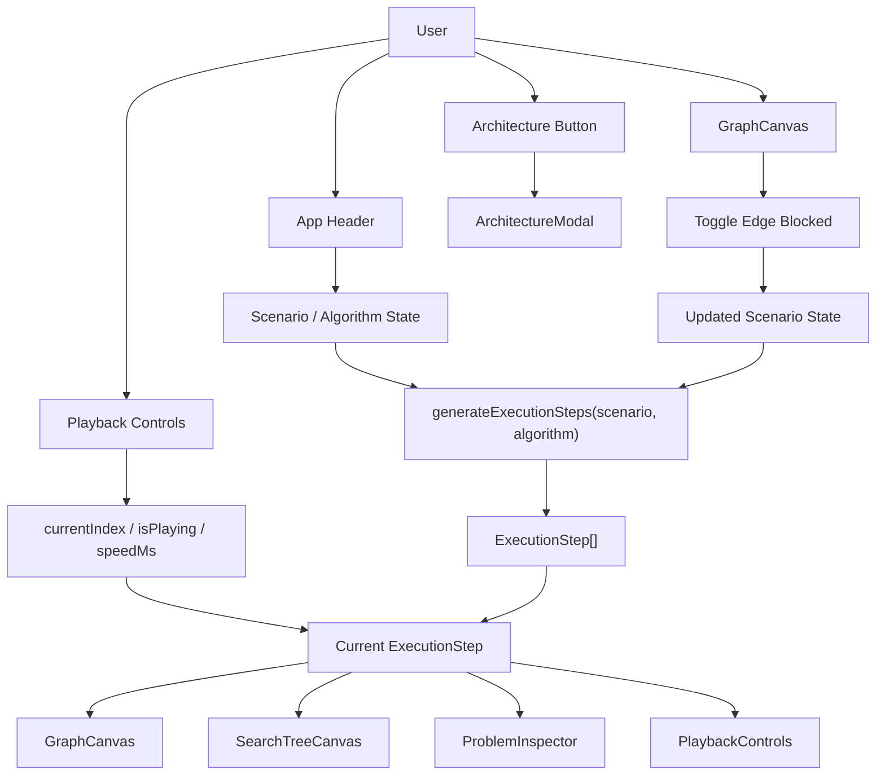
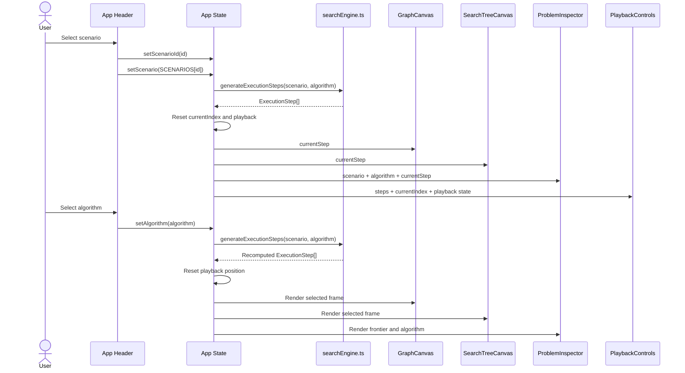
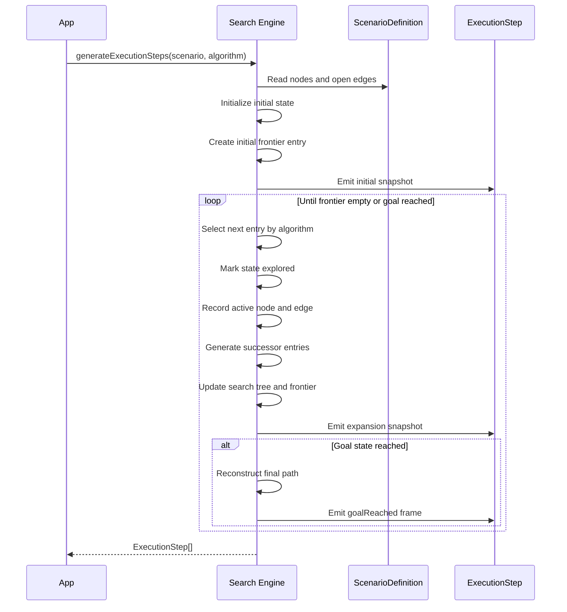
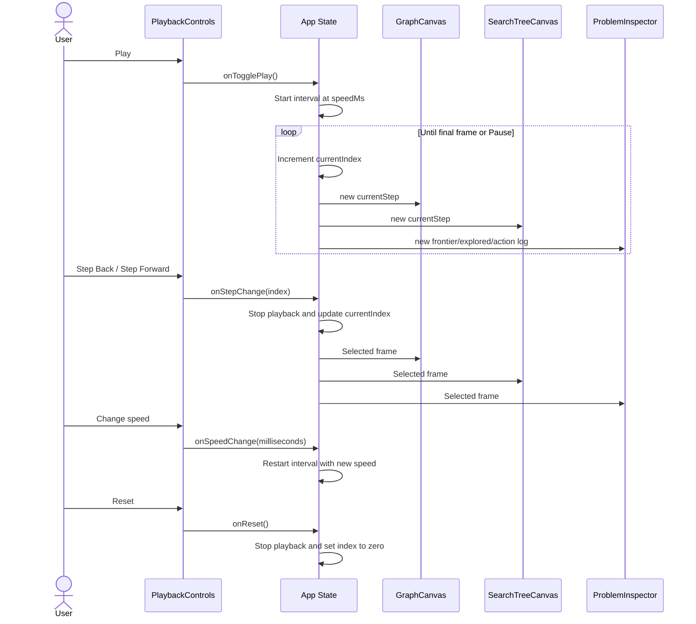
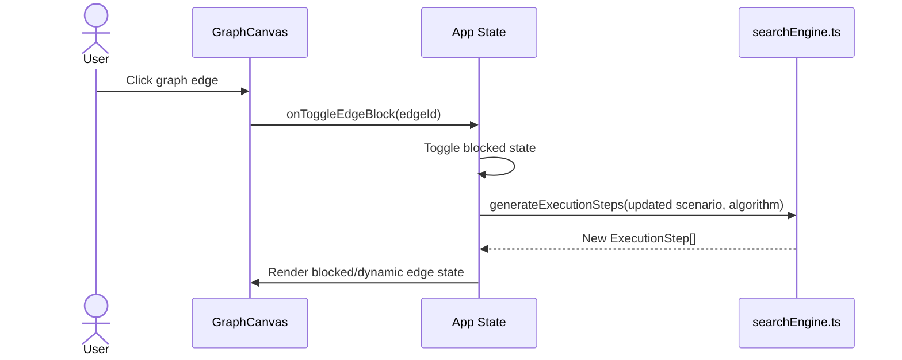
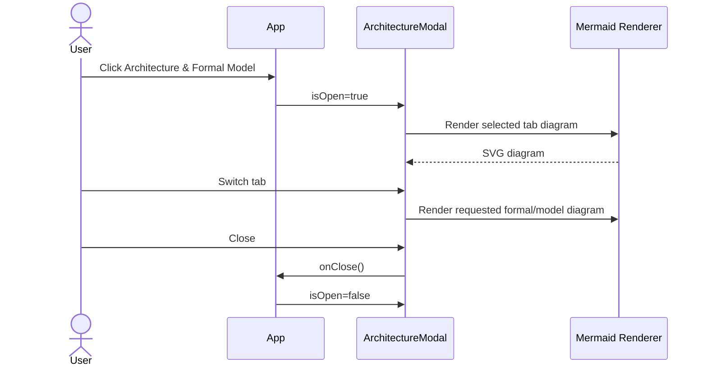

# Call Flow and System Architecture

## 1. Runtime Overview

The application follows a unidirectional data flow:

## 2. Scenario and Algorithm Selection

## 3. Search Step Generation

## 4. Playback Call Flow

## 5. Graph Interaction Call Flow

## 6. Architecture Modal Call Flow

