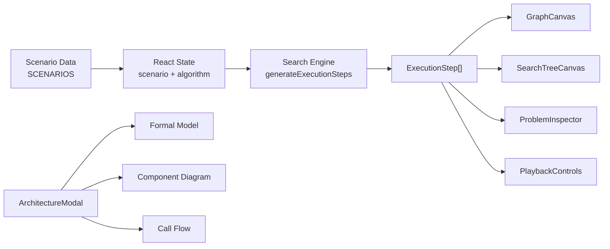

# Formal System Model

## 1. Problem Formulation

The Agentic Navigation System is modeled as the tuple

\[
M=(S,s_0,G,A,T,c,h)
\]

where:

- \(S\) is the finite set of navigation states.
- \(s_0 \in S\) is the initial state.
- \(G \subseteq S\) is the set of goal states; each scenario uses one goal.
- \(A(s)\) is the set of allowed actions at state \(s\).
- \(T(s,a)\) is the deterministic transition from a state and open edge to a successor state.
- \(c(s,s')>0\) is the cost of traversing an open undirected edge.
- \(h(s)\) is the admissible estimated cost from \(s\) to the goal.

A solution is an ordered path
\[
\pi=\langle s_0,s_1,\ldots,s_k\rangle
\]
such that every transition is valid, \(s_k \in G\), and the path cost
\[
g(s_k)=\sum_{i=0}^{k-1}c(s_i,s_{i+1})
\]
is minimized when an optimal-cost algorithm is applied.

## 2. Scenario Instantiations

| Scenario | \(S\) | \(s_0\) | \(G\) | c |
|---|---|---|---|---|
| Smart Campus | \{A,B,C,D,E,F,G,H\} | A | \{D\} | Undirected campus edge weights |
| Hospital Emergency | \{A,B,C,D,E,F,G,H,I\} | A | \{G\} | Undirected hospital edge weights |
| Smart City Traffic | \{A,B,C,D,E,F,G,H,I,J\} | A | \{F\} | Undirected road edge weights |

Each scenario is an undirected weighted graph \(G_v=(V,E,w)\). Graph coordinates do not affect search semantics; they provide deterministic visual layout.

### 2.1 Smart Campus

- State set: \(S=\{A,B,C,D,E,F,G,H\}\)
- Initial state: \(A\), Main Gate
- Goal state: \(D\), Computer Science Department
- Open edges: AB:2, AC:3, BD:4, BE:2, CF:3, CH:5, DG:2, EH:3, FG:4, GH:2

### 2.2 Hospital Emergency

- State set: \(S=\{A,B,C,D,E,F,G,H,I\}\)
- Initial state: \(A\), Emergency Entrance
- Goal state: \(G\), Intensive Care Unit
- Open edges: AB:2, AC:2, BD:3, BI:2, CE:2, CF:4, DH:3, EI:2, FG:3, GH:2, HI:3

### 2.3 Smart City Traffic

- State set: \(S=\{A,B,C,D,E,F,G,H,I,J\}\)
- Initial state: \(A\), Police Station
- Goal state: \(F\), City Hospital
- Open edges: AB:3, AC:2, BD:4, BE:3, CG:4, CI:3, DF:5, EJ:2, FI:4, FJ:3, GH:3, HJ:4

## 3. Actions and Transition Rules

At state \(s\), an action is \(move(s,u)\), where node \(u\) is adjacent to \(s\) through an undirected edge \(e=(s,u)\). Blocked edges are excluded.

For every open edge \((s,u)\) with weight \(w\):

\[
T(s,move(s,u))=u
\]

\[
c(s,u)=w
\]

The successor is not generated if:

1. the edge is blocked (\(blocked=true\));
2. the candidate path cost is no better than an already recorded cost for \(u\); or
3. the successor is outside the scenario state set.

The deterministic state transition may be written as:

\[
\delta(s,a)=
\begin{cases}
u & \text{if } e=(s,u)\in E,\ e.blocked=false \\
\varnothing & \text{otherwise}
\end{cases}
\]

The goal test is:

\[
Goal(s)=
\begin{cases}
\text{true}, & s=s^* \\
\text{false}, & s\ne s^*
\end{cases}
\]

## 4. Heuristic Function

For A*,

\[
f(n)=g(n)+h(n)
\]

where \(g(n)\) is the accumulated path cost and \(h(n)\) is the scenario-specific estimated remaining cost. The provided values are admissible: they never overestimate the true remaining path cost to the goal. Consequently, A* is optimal if the frontier is handled with nondecreasing \(f(n)\) and state costs are not allowed to improve after goal expansion.

## 5. Search Procedures

### 5.1 BFS

BFS expands states in first-in, first-out order. It removes a parent state, generates successors, and appends them to the queue. On unit-cost or nonnegative-cost graphs, BFS is complete and returns a shortest path in number of transitions; it does not minimize weighted cost by itself.

### 5.2 DFS

DFS expands states in last-in, first-out order. It follows one branch deeply before backtracking. It is complete only for finite acyclic search spaces and is not guaranteed to return a minimum-cost path.

### 5.3 UCS

UCS expands the frontier state having the smallest \(g(n)\). It maintains a min-priority queue and uses edge costs as priorities. UCS is complete and optimal for nonnegative edge costs.

### 5.4 A*

A* expands the frontier state having the smallest \(f(n)=g(n)+h(n)\). With admissible h(n), A* is complete and optimal in a graph search where a state may be expanded only after an improved cost is found.

## 6. Execution Framing

Every search operation emits an `ExecutionStep` frame containing the current state, frontier, explored IDs, active edge, search-tree snapshot, action log, goal status, final path, and total path cost. This decouples search computation from visual playback and makes each expansion reproducible.

## 7. Complexity Analysis

Let \(V=|S|\), \(E=|E|\), \(d\) be the maximum search depth, and \(b\) be the maximum branching factor.

| Algorithm | Time | Space | Completeness | Optimality |
|---|---:|---:|---|---|
| BFS | \(O(V+E)\) with adjacency lists | \(O(V)\) | Yes for finite graphs | Minimum hops, not weighted cost |
| DFS | \(O(V+E)\) | \(O(V)\) | Finite acyclic graphs | No |
| UCS | \(O((V+E)\log V)\) with a binary heap | \(O(V)\) | Yes for nonnegative weights | Yes |
| A* | \(O((V+E)\log V)\) worst case | \(O(V)\) worst case | Yes with admissible h and finite graph | Yes with admissible h |

For a depth-bounded tree representation:

- BFS time and space are \(O(b^d)\) in the worst case.
- DFS time is \(O(b^d)\), but space is \(O(bd)\) for a stack-based implementation.
- UCS and A* depend on queue ordering and graph structure; their worst-case state count remains exponential in the represented depth, but UCS/A* generally inspect fewer nodes than uninformed search when costs or heuristics are useful.

The implemented scenarios are bounded graphs with at most ten nodes, so the state and frame storage requirements remain small.

## 8. Component Architecture

